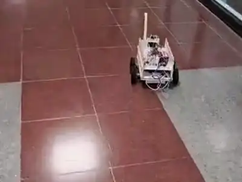
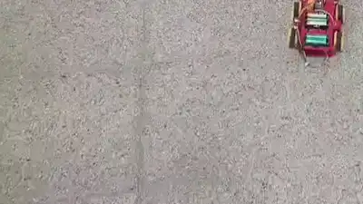

# Robotics projects

Two group robotics projects from the Computer Engineering programme at İzmir Institute of Technology (2026).

| | |
|---|---|
|  | **[P.C.B: an indoor mobile robot for corridor navigation and secure delivery](pcb-delivery-robot/)** CENG 483 · H. N. Kömürcü, D. Karabacak, E. Ertürk, T. İyiarı |
|  | **[PartyBot: a gesture-controlled mecanum robot](partybot/)** CENG 424 Embedded Computer Systems · T. Topcu, E. Ertürk, O. Kansoy, T. Yaraşlı |
