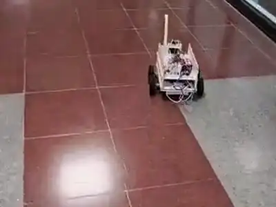
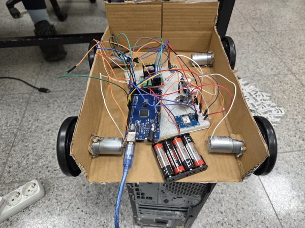
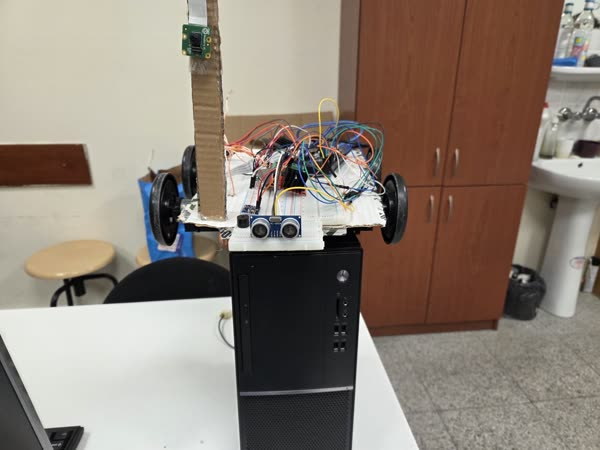
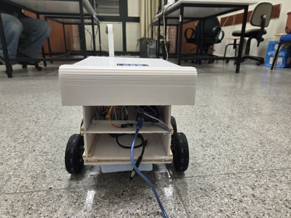
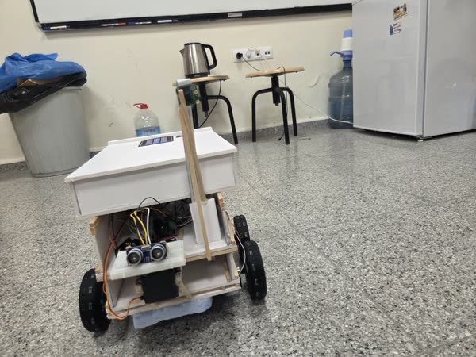

# P.C.B: an indoor mobile robot for corridor navigation and secure delivery

**Hatice Nur Kömürcü, Deniz Karabacak, Emre Ertürk, Tuna İyiarı** · CENG 483, İzmir Institute of Technology, 2026

**[📄 Paper](report.pdf)** · **[▶ Test and progress videos (YouTube)](https://youtube.com/playlist?list=PLwDQJAClSxDNaZMpJzPJgvE02jZJuD9hk)** · **[Demo video](demo.mp4)**

An indoor robot that carries an item between two landmarks in a corridor. At the target a user
unlocks a keypad-secured cargo box, and the robot then returns to its base. It was built through three
mechanical prototypes, with a focus on reuse, recyclable materials and low cost.

- **Architecture.** An Arduino Mega runs low-level real-time control (motors, sensors, lock) and an
  NVIDIA Jetson Nano runs the high-level mission logic.
- **Navigation.** Reactive corridor following uses an ultrasonic range sensor on a scanning servo.
- **Straight-line control.** IMU-aided heading control with a short "smart" calibration that learns
  the gyroscope bias and a motor power-imbalance term, plus a gentle PID heading correction.
- **Mission triggers.** ArUco markers start and stop the robot reliably at the base and the target.
- **Secure cargo.** A keypad, an LCD status display and a servo-actuated lock.

The paper also covers the move from camera-based learning attempts to a robust behaviour-based
navigation stack, and what we learned about power management when adding an embedded GPU.

| | | | |
|---|---|---|---|
|  |  |  |  |
